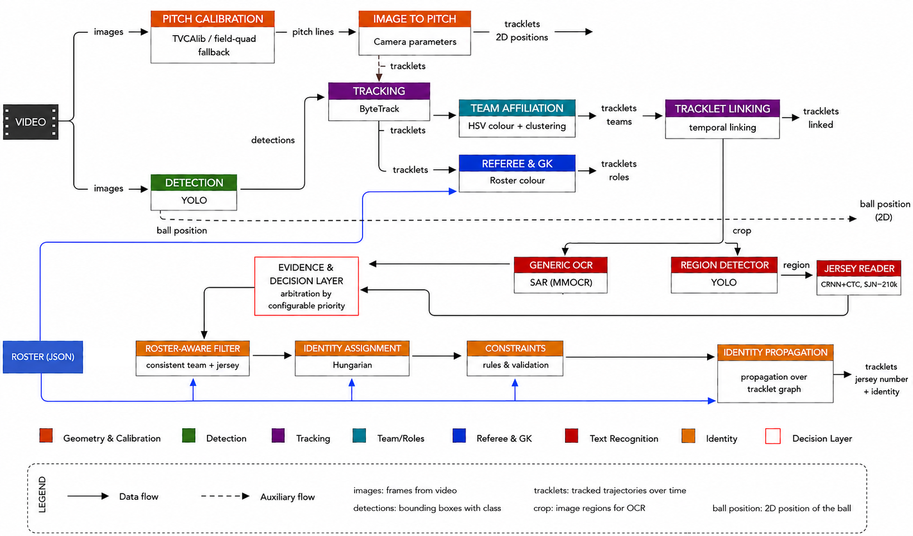

# Football Player Identification

**An end-to-end Computer Vision pipeline for identifying football players in broadcast video.**

This project explores how anonymous player trajectories extracted from televised football matches can be associated with real players from a match roster.

Rather than relying on stadium-installed tracking systems or face recognition, the pipeline combines object detection, multi-object tracking, camera calibration, team and role classification, jersey-number recognition, and roster-aware identity assignment.

The central design principle is **conservative identification: when the evidence is insufficient or contradictory, the system should abstain rather than assign an unreliable identity.**

## Key results

The project investigates how individual components and decision policies affect end-to-end performance.

### End-to-end evaluation

Two configurations differing only in the priority assigned to jersey-number recognition sources were evaluated using GS-HOTA.

| Evaluation | Baseline (Arm A) | Proposed (Arm B) | Improvement |
|---|---:|---:|---:|
| Validation — 12 sequences | 0.2097 | 0.2870 | +0.0772 |
| Test — 12 sequences | 0.2759 | 0.3235 | +0.0476 |

Arm B prioritizes the localized number-region CTC recognizer over the primary OCR source. No model retraining was required for this comparison.

The test evaluation follows a documented, pre-registered protocol. The test split had previously been used for a separate recognizer-pretraining comparison; this additional use is disclosed in the evaluation documentation.

See [`docs/ablation_study_results.md`](docs/ablation_study_results.md) and the [test evaluation protocol](evaluation/jersey_heldout_manifests/gsr_test_final_v1_preregistration.md).

### Jersey-number recognition

A separate controlled evaluation on 774 SoccerNet-GSR test tracklets compared two CTC recognizer checkpoints differing in SJN-210k pre-training.

| Metric | GSR-only training | SJN-210k pre-training |
|---|---:|---:|
| Region coverage | 61.0% | 61.0% |
| Tracklet coverage | 78.2% | 78.2% |
| Correct assigned readings | 249 | 442 |
| Incorrect assigned readings | 356 | 163 |
| Accuracy on assigned readings | 41.2% | 73.1% |

Coverage remained unchanged, while the accuracy of assigned readings improved substantially. This isolates a recognition-quality improvement rather than an increase in the number of predictions.

See [`docs/ablation_study_results.md`](docs/ablation_study_results.md) for the experimental protocol and detailed analysis.

## Pipeline architecture



The processing stages are:

```text
Broadcast video
      |
      v
Scene-cut detection
      |
      v
YOLO object detection
      |
      v
ByteTrack multi-object tracking
      |
      v
Pitch calibration
(TVCalib or field-quadrilateral fallback)
      |
      v
Team assignment — first pass
      |
      v
Referee cues and tracklet linking
      |
      v
Team assignment — second pass
      |
      v
Goalkeeper detection and semantic grouping
      |
      v
Crop and metadata export
      |
      v
Jersey-number recognition
      |
      +---- Primary OCR
      |
      +---- Number-region detector + CTC recognizer
      |
      v
Evidence-based decision layer
      |
      v
Roster-aware filtering
      |
      v
Hungarian tracklet-to-player assignment
      |
      v
Identity constraints and diagnostics
      |
      v
Annotated video + JSON/CSV artifacts
```

The first team-assignment pass provides consistency information for tracklet linking. A second pass re-estimates teams after linking.

The output includes an annotated video and structured artifacts explaining which identities were assigned and which tracklets remained unidentified.

<!--
Optional: add a short demo video or GIF here once it has been committed
to the repository, for example docs/demo.gif.
-->

## Main features

- **Object detection:** YOLO-based detection of people and the ball.
- **Multi-object tracking:** ByteTrack association and stable tracklet generation.
- **Camera calibration:** TVCalib homographies when available, with a field-quadrilateral fallback.
- **Tracklet linking:** temporal, spatial, team-consistency and appearance-based constraints.
- **Team classification:** visual crop-colour evidence and per-frame diagnostics.
- **Role classification:** player, goalkeeper and referee cues.
- **Jersey-number recognition:** EasyOCR, optional MMOCR, and a localized number-region detector with a CTC recognizer.
- **Evidence arbitration:** configurable prioritization of recognition sources without changing the underlying models.
- **Roster-aware filtering:** uses the match roster to constrain candidate jersey numbers.
- **Global identity assignment:** Hungarian assignment between tracklets and roster players.
- **Identity constraints:** prevents duplicate player identities and invalid team/jersey combinations within a frame.
- **Diagnostics and reproducibility:** CSV/JSON outputs, run manifests, evaluation scripts and optional Weights & Biases logging.

## Identity and semantic groups

The pipeline distinguishes between team identity and visualization groups.

`team_id`:

```text
1 = team 1
2 = team 2
```

`semantic_group_id`:

```text
1 = team 1 players
2 = team 2 players
3 = team 1 goalkeeper
4 = team 2 goalkeeper
5 = referees
```

Identity assignment uses team, role, jersey-number evidence and roster constraints. A tracklet can remain unidentified when the available evidence does not justify a reliable assignment.

## Repository structure

```text
ft/
  calibration/       Pitch transformation and calibration fallback
  core/              Immutable evidence records and evidence storage
  decision/           Jersey-number evidence arbitration
  export/             CSV, JSON, crop and metadata export
  features/           Team, role, OCR and visual features
  identity/           Roster parsing, assignment and constraints
  linking/            Tracklet linking
  tracking/           Detection and tracking stages
  utils/              Video I/O and logging helpers
  visualization/      Annotated video rendering

configs/
  default.yaml
  bytetrack_tracking_debug.yaml
  tvcalib_calibration.example.yaml

docs/
  ArchitetturaTesi.png
  ablation_study_results.md
  additional_thesis_metrics.md
  evaluation_results.md
  gsr_detection_tracking_benchmark.md
  Tesi_Magistrale_IngInf.pdf

evaluation/
  gsr_jersey_ocr/
  jersey_heldout_manifests/

scripts/
  train_yolo_gsr_full.py
  run_costume_videos.sh
  run_test_final_v1.sh

tests/
  test_identity.py
  test_number_region.py
```

Local videos, generated artifacts, model weights, evaluation outputs and experiment logs are not committed to the repository.

## Installation

The project requires Python 3.9 or newer.

Clone the repository and create an isolated environment:

```bash
git clone https://github.com/Cappetti99/football-player-identification.git
cd football-player-identification

python3 -m venv .venv
source .venv/bin/activate

python3 -m pip install --upgrade pip
python3 -m pip install -r requirements.txt
python3 -m pip install -e .
```

For the optional OCR dependencies:

```bash
python3 -m pip install -e ".[ocr]"
```

### Optional MMOCR backend

MMOCR is optional. Its OpenMMLab dependencies have strict compatibility requirements and are best installed in a separate environment following the relevant installation instructions.

When MMOCR is unavailable, the `mmocr_easyocr` configuration can fall back to EasyOCR where supported.

## Quick start

A full inference run requires:

- A broadcast football video.
- A compatible YOLO checkpoint.
- Optionally, a roster JSON file.

**The repository does not include a ready-to-run video or the trained model weights.** Supply your own files before running inference.

Set the paths to your local inputs:

```bash
VIDEO_PATH="/path/to/match.mp4"
MODEL_PATH="/path/to/model.pt"
OUTPUT_PATH="output_videos/demo.mp4"
ARTIFACTS_DIR="artifacts/demo"
```

Run the pipeline:

```bash
python3 -m ft.cli run \
  --config configs/default.yaml \
  --video-path "$VIDEO_PATH" \
  --model-path "$MODEL_PATH" \
  --output-path "$OUTPUT_PATH" \
  --artifacts-dir "$ARTIFACTS_DIR" \
  --max-frames 900
```

To use a roster, add the following argument to the command:

```bash
--roster-path "/path/to/roster.json"
```

The maximum number of frames can be adjusted to control the length of the run.

### Processing a folder

The batch mode discovers videos directly inside the specified input directory.

```bash
python3 -m ft.cli run \
  --config configs/default.yaml \
  --input-dir "/path/to/videos" \
  --model-path "/path/to/model.pt" \
  --output-dir output_videos/demo \
  --artifacts-root artifacts/demo \
  --max-frames 900 \
  --limit 3
```

For nested per-match directories, use the single-video command for each match or a shell wrapper.

## Required input formats

### Custom video

The expected per-match directory structure is:

```text
costume-video/
  MatchName/
    MatchName.mp4
    MatchName.json
```

The JSON file is optional and contains roster information when available. The `costume-video/` directory is ignored by Git except for its placeholder files.

### Roster JSON

A roster is a list of players and match officials. For example:

```json
[
  {
    "player_id": "team1_10",
    "name": "Example Player",
    "team_id": 1,
    "jersey_number": 10,
    "role": "player",
    "position_prior": [46.0, 24.0],
    "visual_embedding": null,
    "metadata": {
      "team": "Team 1",
      "role_hint": "striker"
    }
  },
  {
    "player_id": "team1_gk_01",
    "name": "Example Goalkeeper",
    "team_id": 1,
    "jersey_number": 1,
    "role": "goalkeeper",
    "position_prior": [8.0, 34.0],
    "visual_embedding": null,
    "metadata": {
      "team": "Team 1",
      "kit_color": "black"
    }
  },
  {
    "player_id": "referee_yellow",
    "name": "Example Referee",
    "team_id": null,
    "jersey_number": null,
    "role": "referee",
    "position_prior": null,
    "visual_embedding": null,
    "metadata": {
      "kit_color": "yellow"
    }
  }
]
```

Important constraints:

- Players use `team_id` 1 or 2; referees use `null`.
- Jersey numbers, when present, must be between 1 and 99.
- Each team should contain each jersey number at most once.
- `position_prior` is optional and uses a 105 × 68 metre pitch coordinate system.
- Supported kit-colour names include `black`, `yellow`, `fluorescent_yellow`, `orange`, `red`, `blue` and `light_blue`. Hex colours are also supported.

## Camera calibration

The default calibration uses a lightweight field-quadrilateral fallback. For experiments requiring accurate pitch positions, the pipeline can consume TVCalib `per_sample_output.json` files and use homographies for sampled frames.

Expected input:

```text
evaluation_outputs/tvcalib/<MatchName>/per_sample_output.json
```

An example configuration is available in the repository. A TVCalib record should contain a `homography` field and frame-identification information such as `image_id`, `frame` or `frame_index`.

The `tvcalib_centered` coordinate system converts centred field coordinates into the FT pitch system `[0, 105] × [0, 68]`. Use `ft` only when the homography already uses the FT top-left pitch coordinate system.

Calibration diagnostics are written to the run's metadata directory.

## Evaluation

The repository includes separate evaluation workflows for recognition, detection, tracking and end-to-end identity-related performance.

### GS-HOTA and decision-policy experiments

The main experiment compares two jersey-number source-priority policies. The reported evaluation uses 12 validation sequences and 12 sampled test sequences.

The detailed report includes:

- GS-HOTA and component metrics.
- Sequence-level bootstrap confidence intervals.
- Paired comparisons between configurations.
- Oracle ablations to estimate the impact of individual stages.
- Limitations and caveats affecting interpretation.

See [`docs/ablation_study_results.md`](docs/ablation_study_results.md) and [`docs/additional_thesis_metrics.md`](docs/additional_thesis_metrics.md).

### Detection and tracking benchmark

The SoccerNet-GSR benchmark evaluates detection and tracking before and after FT tracklet linking.

It reports detection precision and recall, HOTA, DetA, AssA, LocA, MOTA, IDF1, identity switches, fragmentation, coverage and diagnostic charts.

See [`docs/gsr_detection_tracking_benchmark.md`](docs/gsr_detection_tracking_benchmark.md) for the evaluation protocol and commands.

### Controlled jersey OCR evaluation

The `evaluation/gsr_jersey_ocr/` suite evaluates jersey-number recognition using ground-truth boxes and track IDs. This isolates OCR performance from errors introduced by detection, tracking and identity assignment.

Example:

```bash
python3 evaluation/gsr_jersey_ocr/run_eval.py \
  --gsr-dir "$SOCCERNET_GSR" \
  --output-dir evaluation_outputs/gsr_jersey_ocr/easyocr_val \
  --split val \
  --max-sequences 10 \
  --max-tracklets 1000 \
  --backend easyocr
```

Before running this command, set `SOCCERNET_GSR` to the local SoccerNet-GSR dataset directory. The available options depend on the selected OCR backend.

Main outputs include `metrics.json`, `predictions.csv`, `confusion.csv`, `threshold_sweep.csv` and `ocr_diagnostics.json`.

For the experimental results and their metric definitions, see [`docs/evaluation_results.md`](docs/evaluation_results.md).

## Training the YOLO detector

The helper `scripts/train_yolo_gsr_full.py` converts SoccerNet-GSR into a YOLO dataset and supports three label modes:

- `person_ball`: players, goalkeepers and referees merged into `person`, plus `ball`.
- `person_only`: a single person class.
- `four_class`: `ball`, `goalkeeper`, `player` and `referee`.

Example:

```bash
python3 -u scripts/train_yolo_gsr_full.py \
  --gsr-dir "$SOCCERNET_GSR" \
  --output-dir "$SOCCERNET_YOLO_OUTPUT" \
  --mode person_ball \
  --base-model yolo26x.pt \
  --epochs 20 \
  --imgsz 768 \
  --batch 2 \
  --device 0 \
  --workers 4 \
  --project runs/ft_yolo_gsr \
  --name yolo26x_gsr_person_ball_768_e20
```

Set `SOCCERNET_GSR` and `SOCCERNET_YOLO_OUTPUT` to valid local paths before running the command. Training also requires the base model and the appropriate compute resources.

The detector is only the first stage of the system: improved detections do not automatically guarantee correct player identities.

## Main outputs

A typical run writes an annotated video and artifacts under the configured output directories.

Common metadata files include:

| Artifact | Purpose |
|---|---|
| `*_tracklets.json` / `*_tracklets.csv` | Per-frame tracklet metadata |
| `*_tracklet_summaries.csv` | Summary for each display track ID |
| `*_candidate_scores.csv` | Hungarian assignment candidate costs |
| `*_identity_candidates.csv/json` | Diagnostic candidates for unknown tracks |
| `*_identity_evidence.csv/json` | Evidence collected before identity assignment |
| `*_identity_decisions.csv/json` | Decisions after identity constraints |
| `*_jersey_ocr.json` | OCR detections, votes and candidates |
| `*_constraints.json` | Identity-constraint diagnostics |
| `*_linking.json` | Tracklet-linking diagnostics |
| `*_calibration.json` | Calibration source and frame-matching diagnostics |
| `*_run_manifest.json` | Resolved configuration and run provenance |
| `*_run_diagnostics.json` | Timing and artifact-size diagnostics |

Additional artifacts are generated when number-region OCR, PRTReID or other optional components are enabled.

OCR results can be cached between runs when `jersey_ocr.cache_enabled` is enabled. The default cache directory is `.ft_cache/ocr/jersey_ocr/`.

## Testing

Run the available lightweight regression tests and inspect the command-line interface:

```bash
PYTHONDONTWRITEBYTECODE=1 PYTHONPATH=. python3 tests/test_identity.py
PYTHONDONTWRITEBYTECODE=1 PYTHONPATH=. python3 tests/test_number_region.py

python3 -m ft.cli --help
python3 -m ft.cli run --help
```

These checks are useful for regression testing, but they do not replace a full evaluation on the required datasets and model checkpoints.

## Current limitations

- Broadcast cuts and camera changes can break temporal continuity.
- ByteTrack IDs are temporal tracking identifiers, not real player identities.
- Jersey-number OCR remains sensitive to image quality, pose, motion blur and occlusion.
- The number-region detector is trained on GSR crops and transfers poorly to some out-of-domain broadcast footage.
- TVCalib calibration is substantially more reliable than the simple field-quadrilateral fallback for pitch-position evaluation.
- Team assignment can abstain on many players in some sequences. Since downstream identity assignment requires consistent team information, these abstentions propagate into end-to-end errors.
- MMOCR requires a heavier dependency stack than the lightweight runtime.
- PRTReID and number-region OCR remain experimental components that should be validated on the target video domain.
- The reported GS-HOTA results concern SoccerNet-GSR and the documented evaluation samples. They should not be interpreted as proof of equivalent performance on arbitrary broadcast footage.
- The test split has already been used for a recognizer-pretraining comparison and for the subsequent pre-registered policy evaluation. This reuse is documented in the experimental protocol.

## Project status

The thesis work supported by this repository is complete. The pipeline, evidence-based decision layer and evaluation workflows are documented, and the promoted configuration has been evaluated on SoccerNet-GSR.

The repository is maintained as an experimental research project and as the source of the artifacts supporting the reported results. It is not a production-ready product, and no backward-compatibility or support guarantee is offered.

## Future work

The experiments suggest several directions for further research:

1. **Improve domain transfer:** train the number-region detector on more diverse broadcast-like footage.
2. **Investigate team-classification abstention:** determine why team evidence is unavailable for many players in some sequences.
3. **Explore pose-derived jersey regions:** evaluate whether pose information can replace or complement the learned region detector.
4. **Refine the evidence-promotion criterion:** measure the trade-off between coverage and incorrect identity assignments.
5. **Improve tracklet linking:** investigate candidate generation when the correct continuation is missing.
6. **Expand evaluation:** assess generalization across more matches, camera conditions and competitions.

## License and third-party components

The project root contains an MIT license. However, individual third-party components and assets may be subject to their own licenses and restrictions.

In particular, the documented PRTReID-related methods and weights derive from [`jersey-number-pipeline`](https://github.com/mkoshkina/jersey-number-pipeline), which is subject to **CC BY-NC 3.0** for the relevant material. Its terms must be respected independently of the root repository license.

Model weights and datasets are not automatically covered by the project's MIT license. Check the original terms before downloading, redistributing or using them commercially.

## Thesis

The full thesis is available in [`docs/Tesi_Magistrale_IngInf.pdf`](docs/Tesi_Magistrale_IngInf.pdf).

